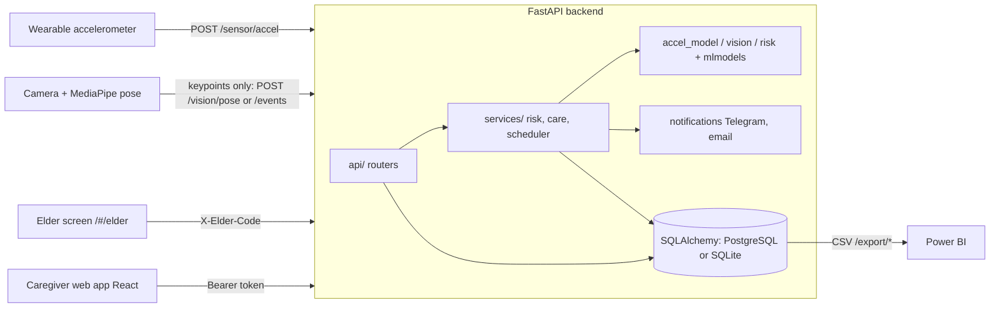

# Architecture

## Backend layout (`backend/app/`)
| Path | Role |
|---|---|
| `main.py` | app creation, CORS, language middleware, router registration (also re-exports old names for compatibility) |
| `core/config.py`, `core/logging_config.py` | environment settings (production refuses demo secrets), logger `elderlife` |
| `db/database.py`, `db/models.py` | engine/session, models with foreign keys (SQLite gets `PRAGMA foreign_keys=ON`) |
| `security.py` | PBKDF2 password hashes, signed tokens, dependencies for login/admin/device/elder |
| `schemas.py` | request bodies |
| `services/` | `people` (who may see whom), `risk_service` (signals, evaluate, close alerts), `care` (shared helpers), `scheduler` (background loop: escalation, check-ins, baselines) |
| `api/` | routers: auth_admin, elderly, events, sensors, careplan, elder_self, alerts, analytics, demo |
| `risk.py`, `mlmodels.py`, `vision.py`, `accel_model.py`, `pose_extractor.py` | risk engine (rules + logistic model + safety floor), pure-Python logistic regression, pose classifier, optional scikit-learn accelerometer model, MediaPipe wrapper |
| `i18n.py` | English/Arabic messages (reasons stored as keys and translated when read) |
| `alembic/` | migrations (baseline `0001`); `database/migrations/*.sql` is the plain-SQL equivalent |

The split of the old 35 KB `main.py` was done mechanically (AST) and verified by: the same 31 routes still registered (`tests/test_structure.py`), a name checker (`tools/check_names.py`), and the unit tests. **It has not been run against a real FastAPI/SQLAlchemy yet** (see LIMITATIONS.md).

## Frontend (`frontend/src/`)
React + Vite. `App.jsx` (pages), `components.jsx` (Status, Sparkline, Bars), `lib/charts.js` (pure chart maths), `i18n.jsx` + `locales/en.js|ar.js` (English/Arabic, RTL via `dir`), `api.js`.

## ML (`ml/`)
`common.py` (synthetic generators), `preprocessing/`, `features/`, `training/`, `evaluation/`, `inference/`, `models/`, `reports/`, `data/` (raw data is git-ignored). The backend does not import `ml/`: it receives model files (`python ml/export_to_backend.py`, `train_risk.py --install`, `train_pose.py --install`).
