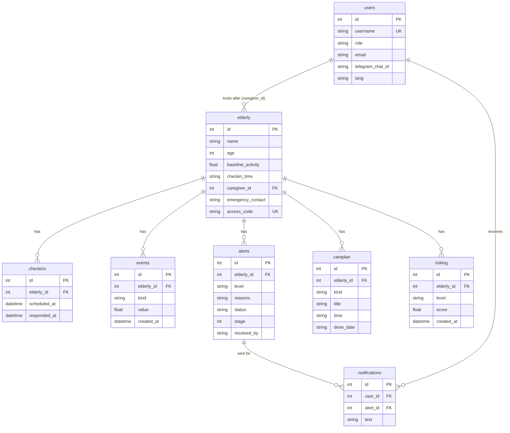

# Database design

Source of truth: `database/migrations/0001_initial.sql` (copied to `data_preparation_and_db/schema.sql`). It matches the SQLAlchemy models in `backend/app/main.py` and adds the foreign keys and CHECK constraints the models do not declare yet (the running app stores the ids as plain integers). Verified by loading it into SQLite with foreign keys on and checking that a bad FK and a bad `events.kind` are rejected. Not yet verified on PostgreSQL.

## Planned tables (`0002_planned_ml_tables.sql`, not used by the app yet)
`activity_baselines` (per person and hour) and `ml_predictions` (audit of model outputs). Today the baseline is one number in `elderly.baseline_activity`.

## Notes
- Roles are `admin` and `caregiver` (the person uses an access code, not a user row).
- `alerts.reasons` stores message keys plus parameters, translated when read.
- Timestamps are server local time (a known limitation, see LIMITATIONS.md).
- The old 5-table schema (`sensor_logs`, `fall_alerts`, ...) did not match the app and was replaced.
